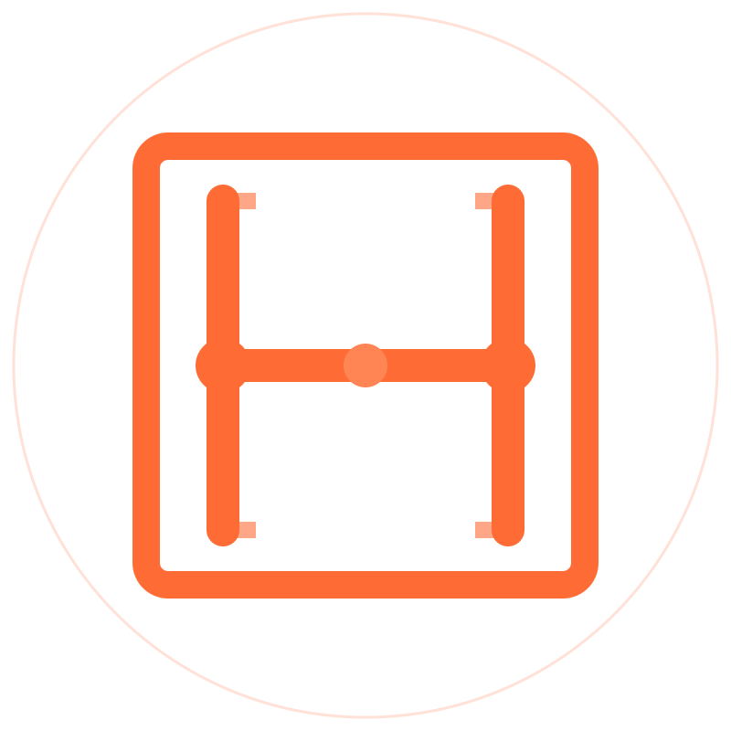

<picture>
  <source media="(prefers-color-scheme: dark)" srcset="assets/hdds-logo-dark-bg-800.png">
  
</picture>

# HDDS

**High-performance Data Distribution Service**

Pure-Rust DDS/RTPS middleware. Designed and built in France.

Its design draws on the author's earlier engine and language work rather than on
an existing DDS stack.

[Website](https://hdds.io) · [Documentation](https://docs.hdds.io) · [Core repository](https://github.com/hdds-team/hdds) · [Demos](https://github.com/hdds-team/hdds_packs) · Contact: [olivier@hdds.io](mailto:olivier@hdds.io)

---

## What it implements

A from-scratch implementation of the OMG specifications, in pure Rust with no C
core underneath:

- **DDS v1.4** -- the data-centric API. All 22 QoS policies have types and
  builders; not every one changes runtime behaviour yet.
- **RTPS v2.4** -- the wire protocol, announced as version 2.4 for the widest
  interoperability. INFO_SRC and INFO_REPLY are recognised on receive but not
  emitted.
- **DDS-XTypes 1.3** -- TypeIdentifier/TypeObject, type compatibility checking
  and type announcement in discovery; XCDR1 and XCDR2, mutable and appendable
  extensibility. Runtime TypeLookup is HDDS-only and behind a feature, and the
  XCDR2 encoder has documented layout deviations.
- **DDS-Security 1.1** -- authentication, access control and AES-256-GCM
  payload encryption plugins, HDDS-to-HDDS, behind the `security` feature. For
  user data, protection covers the payload: metadata and whole-message
  protection are not implemented, so the control submessages of user endpoints
  travel unauthenticated. The secure discovery endpoints can themselves be
  signed or encrypted. Payload SIGN and cross-vendor
  security interoperability are not covered. The
  [security guide](https://github.com/hdds-team/hdds/blob/master/docs/security-guide.md)
  states the protection boundary in full, including what an on-path attacker can
  still do and which key-management and replay protections are absent.
- Officially registered RTPS vendor ID **`{0x01, 0x1A}`**
  ([DDS Foundation registry](https://www.dds-foundation.org/dds-rtps-vendor-and-product-ids/)).

Each line above is a scope, not a blanket claim. The
[conformance matrix](https://github.com/hdds-team/hdds/blob/master/docs/CONFORMANCE_MATRIX.md)
and the core README state, feature by feature, what is implemented, what is
accepted but inert, and what is absent.

The core and the generator are open source under **Apache-2.0 OR MIT**, at your
option.

HDDS ships the `shape_main` example that drives the
[OMG DDS-RTPS interoperability test suite](https://github.com/omg-dds/dds-rtps),
the public suite the OMG uses for DDS interoperability, so you can run it
against HDDS on your own machine rather than take our word for anything. The
command is in the core repository's README; the suite brings its own Python
prerequisites.

## The stack

| Project | What it is |
|---------|------------|
| [hdds](https://github.com/hdds-team/hdds) | The middleware: DDS, RTPS, XTypes and DDS-Security in pure Rust. SDKs for C, C++, Python, Rust and TypeScript. `no_std` support through `hdds-micro`, which talks to HDDS participants only - no discovery in the crate, XCDR1 little-endian samples - and is not a general-purpose, vendor-interoperable RTPS stack. ROS 2 support via `rmw_hdds`: measured on Humble, builds expected on Iron and Jazzy with no recorded run. On [crates.io](https://crates.io/crates/hdds), where a published version can lag this repository. |
| [hdds_gen](https://github.com/hdds-team/hdds_gen) | OMG IDL 4.2 parser and code generator, seven targets: Rust, C, C++, Python, TypeScript, plus `no_std` Rust and header-only C for microcontrollers. Generated Rust code needs a matching core: hddsgen 2.0 pairs with HDDS 1.5. Coverage differs by target, and the generator's own documentation states it target by target. On [crates.io](https://crates.io/crates/hddsgen). |
| [hdds_packs](https://github.com/hdds-team/hdds_packs) | Demonstration projects, from air-defense radar to smart factory. |
| [HDDS Viewer](https://hdds.io) | Real-time DDS observability and capture-replay desktop tool (commercial). |
| [HDDS Studio](https://hdds.io) | Visual IDL editor with round-trip fidelity (commercial). |

## Also on this account

| Project | What it is |
|---------|------------|
| [devit](https://github.com/hdds-team/devit) | Security sandbox for AI coding agents: approval engine, HMAC-signed operations, immutable audit trail. |
| [aircp](https://github.com/hdds-team/aircp) | Real-time multi-agent AI collaboration, powered by HDDS. |
| [bitnet-arc](https://github.com/hdds-team/bitnet-arc) | BitNet ternary kernels on Intel Arc GPUs. |

---

Architecture and technical direction are human. The Rust implementation is
developed with an AI-assisted pipeline: code review, quality guardrails and
audit campaigns. Release tags are OpenPGP-signed with key
<code>81D4B24C3CBDECCE3DCD65B010ACC278D4677B1D</code> (olivier@hdds.io), published on
keys.openpgp.org.

